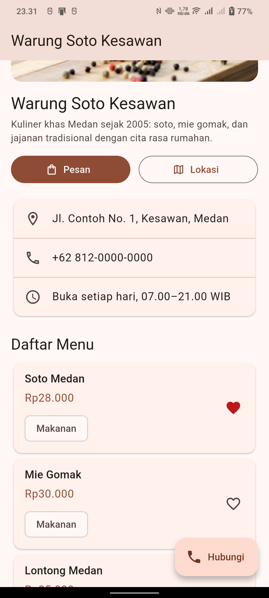
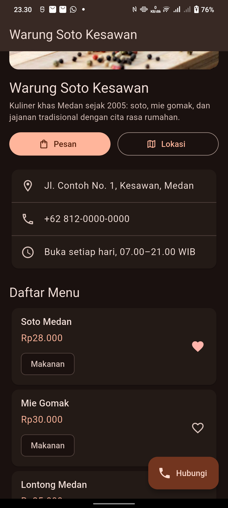

# Halaman Menu UMKM Kuliner Medan
Aplikasi satu halaman untuk usaha kuliner fiktif **Warung Soto Kesawan**.
Pengunjung dapat melihat identitas usaha, kontak, dan daftar menu, serta menandai menu favorit.

## Identitas
- Nama  : M. FARIS AL RAFIQ
- NIM   : 4241250001
- Kelas : PSIK24C

## Fitur
- Tema Material 3 dari satu seed color (`ColorScheme.fromSeed`), mendukung mode terang dan gelap.
- Bagian kepala: gambar, nama usaha, dan deskripsi singkat.
- Kartu kontak (`Card` + `ListTile`): alamat, telepon, dan jam buka.
- Daftar 5 menu, masing-masing ditampilkan oleh widget `KartuMenu` (nama, harga, kategori dalam `Chip`).
- Tombol favorit (ikon hati) pada setiap menu: ikon berubah dan muncul `SnackBar`.
- Komponen Material 3 yang dipakai: `FilledButton`, `OutlinedButton`, `IconButton`, `FloatingActionButton`, `Card`, dan `Chip`.

## Tangkapan Layar
| Mode terang | Mode gelap |
|---|---|
|  |  |

## Diagram Widget Tree
(S) = StatelessWidget, (F) = StatefulWidget

```
UmkmApp (S)
└─ MaterialApp            [theme + darkTheme, ColorScheme.fromSeed]
   └─ HalamanMenu (S)
      ├─ AppBar
      ├─ SingleChildScrollView
      │  └─ Center > ConstrainedBox > Column
      │     ├─ _KepalaUsaha (S)   [Image.network, Text nama, Text deskripsi]
      │     ├─ Row                [FilledButton.icon, OutlinedButton.icon]
      │     ├─ _KartuKontak (S)   [Card > Column > 3x ListTile]
      │     ├─ Text "Daftar Menu"
      │     └─ KartuMenu x5 (S)
      │        └─ Card > Row
      │           ├─ Column       [Text nama, Text harga, Chip kategori]
      │           └─ TombolFavorit (F)   <- satu-satunya Stateful
      │              └─ IconButton [Icon favorite / favorite_border]
      └─ FloatingActionButton.extended
```

## Penjelasan Arsitektur dan Pemilihan Stateless/Stateful
Flutter membangun tampilan dengan menggunakan tiga pohon yang saling berhubungan. Widget tree merupakan susunan widget yang saya tulis di dalam method `build()`, seperti `MaterialApp`, `Scaffold`, `Column`, dan `KartuMenu`. Widget hanya menyimpan pengaturan tampilan yang ringan dan tidak dapat diubah. Karena itu, widget dibuat kembali setiap kali `build()` dijalankan. Element tree menghubungkan setiap widget dengan posisinya di layar. Element dapat bertahan lebih lama, menyimpan objek `State`, dan menjadi `BuildContext`. Ketika `setState()` dipanggil, Flutter membandingkan widget yang baru dengan widget sebelumnya. Jika tipe dan key keduanya sama, Flutter akan menggunakan kembali element yang sudah ada. Render tree berisi `RenderObject` yang mengatur ukuran dan posisi tampilan (layout), kemudian menggambarnya ke layar (paint). Dengan begitu, Flutter cukup memperbarui bagian yang mengalami perubahan.

Dalam aplikasi ini, sebagian besar bagian menggunakan Stateless karena tampilannya hanya bergantung pada parameter. Bagian tersebut meliputi `UmkmApp`, `HalamanMenu`, `_KepalaUsaha`, `_KartuKontak`, dan `KartuMenu`. Sementara itu, `TombolFavorit` menggunakan Stateful karena menyimpan nilai yang dapat berubah, yaitu status favorit (`_favorit`). Saya memisahkannya menjadi bagian kecil agar ketika ikon hati ditekan, hanya tombol tersebut yang dibangun ulang, bukan seluruh halaman. Selain itu, warna menggunakan `Theme.of(context).colorScheme` supaya tampilannya dapat mengikuti mode terang maupun gelap secara otomatis.

## Cara Menjalankan
```
flutter pub get
flutter run
flutter analyze
flutter test
```

## Pengujian
Satu widget test (`test/widget_test.dart`) memeriksa bahwa setelah tombol favorit ditekan, ikon berubah dari `favorite_border` menjadi `favorite` dan `SnackBar` muncul.

## Pernyataan Penggunaan AI
Saya menggunakan Claude (asisten AI) untuk membantu menyusun kerangka kode aplikasi, widget test, dan draf awal README ini. Setelah itu saya menjalankan dan menguji aplikasi di HP Android, memperbaiki error yang muncul (misalnya berkas `data.dart` yang belum terbaca), serta menyesuaikan isi dan bahasa README dengan pemahaman saya sendiri.